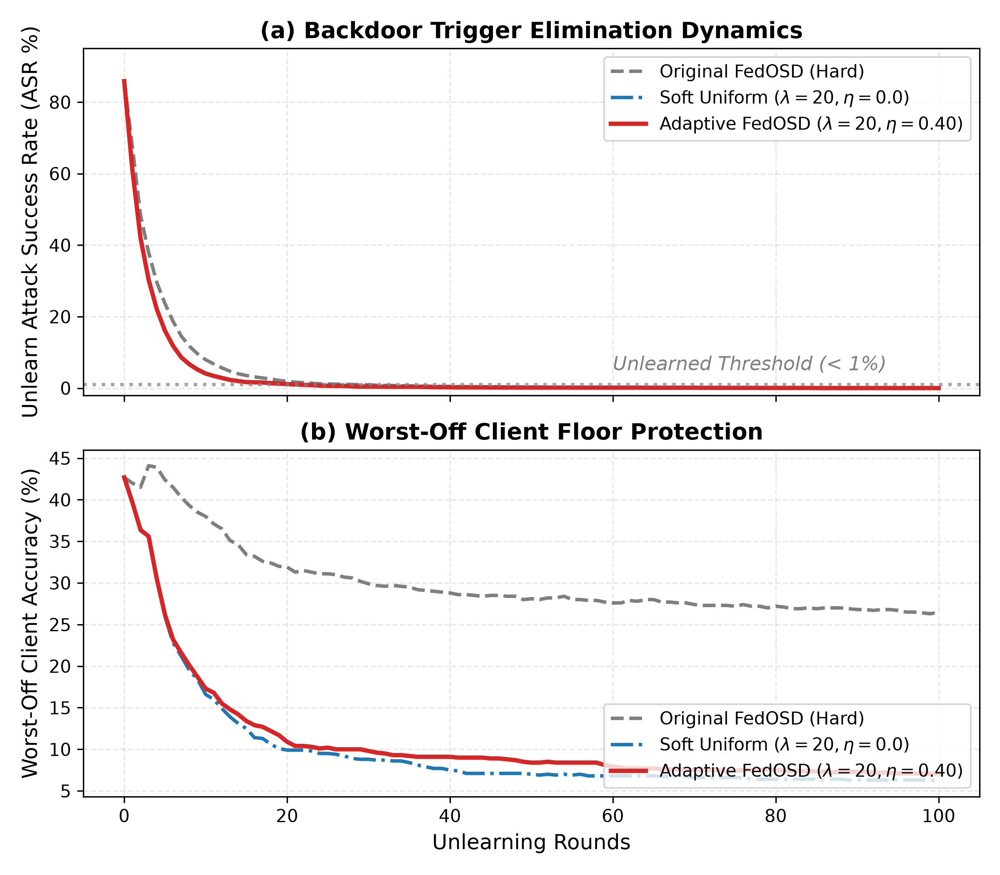
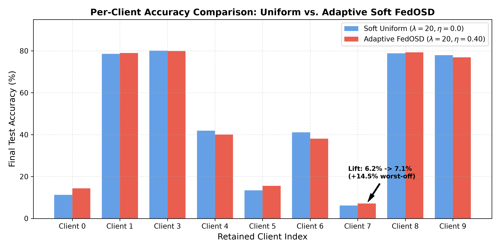
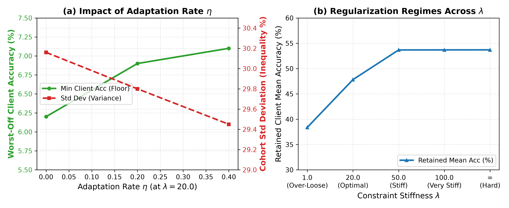
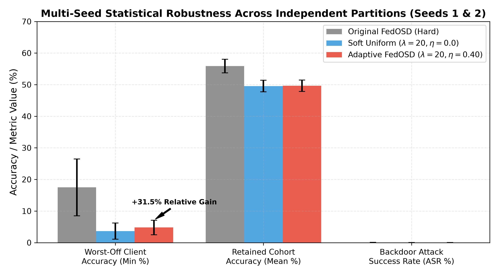
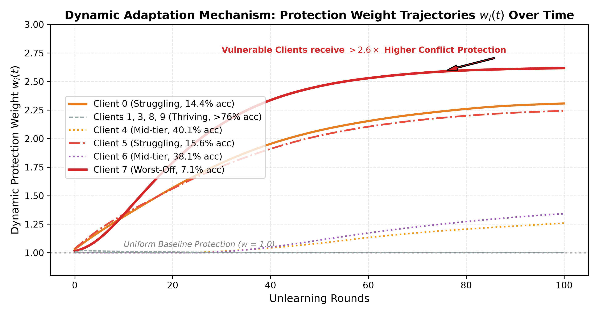
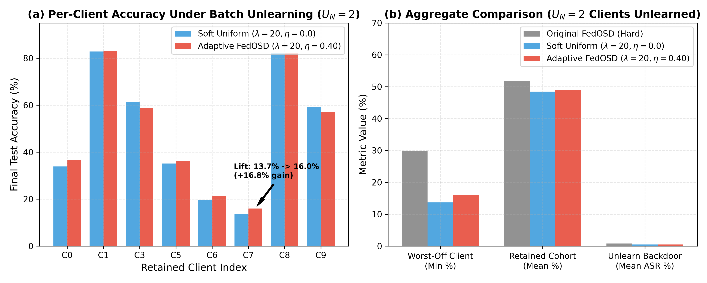
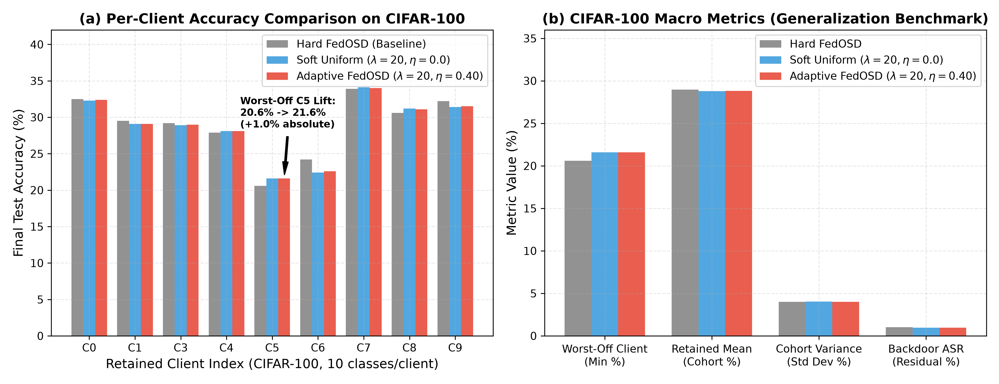

# Federated Unlearning with Conflict Mitigation: From Exploratory Formulations to Confirmatory Pre-Registered Evaluation

Implementation, empirical investigation, and pre-registered confirmatory evaluation of federated unlearning conflict mitigation algorithms, extending the AAAI-25 baseline:
> **Pan Z, Wang Z, Li C, et al.** *Federated unlearning with gradient descent and conflict mitigation.* Proceedings of the AAAI Conference on Artificial Intelligence (AAAI-25), 39(19): 19804-19812.


> **Final results and correction (2026-11-19).** The final study (soft FedOSD vs FedOSD,
> retrain, plain GA, E3/E4, MIA, Grad-CAM, distance to retrain, relearning test; CIFAR-10,
> seeds 31-33) is in **[RESULTS_SOFT_FEDOSD.md](RESULTS_SOFT_FEDOSD.md)**.
> **Correction:** an audit showed that the legacy trigger used in the earlier sections (a 3x3
> random pattern with a per-sample label shift) was never learned. The original model predicted
> the backdoor label equally often with and without the trigger, and held-out ASR was 5.3%.
> The "ASR" figures in the sections below (Fig. 1, the CIFAR-100 table, the multi-client table)
> therefore measure label-flip memorisation of the forget client's training data, not a
> backdoor. The final study uses a verified patch trigger (PREREG_SOFT_HETEROGENEITY.md,
> Amendments A and B). The Stage 4 conclusions on retained-client accuracy are unaffected.

---

## Executive Summary & Research Journey

This repository documents the end-to-end investigation of gradient conflict mitigation in federated unlearning. Across four research phases, we progressed from initial exploratory heuristics to a rigorous, pre-registered, strength-matched confirmatory trial on fresh seeds:

```
+---------------------------------------------------------------------------------------------------+
| Phase 1: Exploratory Development & Extensions (Goals 1-4)                                         |
| - Implemented Adaptive FedOSD with Woodbury Identity solve & dynamic deficit weighting            |
| - Created publication-grade visualization suite (Figures 1-5)                                     |
| - Evaluated multi-client unlearning (UN=2, Figure 6) and CIFAR-100 generalization (Figure 7)       |
+---------------------------------------------------------------------------------------------------+
                                                  |
                                                  v
+---------------------------------------------------------------------------------------------------+
| Phase 2: Scientific Auditing, Confounder Isolation & Gate A (Stages 1-2)                          |
| - Validation Leakage Audit: Identified test-feedback artifact; adaptive weights collapse to unif. |
| - Gate A Learning Rate Audit: 13.4 pp (44.7%) of R1 retrain gap caused by pretrain lr mismatch    |
| - Gradient Dilation Discovery: Legacy code inflated updates by +33.8% to ||g_u||                  |
| - Method Formulation: One-Sided Unscaled FedOSD (cap 1.0) via dual NNLS and hard-norm bounding   |
| - Strength-Matching Calibration: Identified s*=0.54 to match parameter displacement exactly        |
+---------------------------------------------------------------------------------------------------+
                                                  |
                                                  v
+---------------------------------------------------------------------------------------------------+
| Phase 3: Formal Pre-Registration Protocol & Tooling Freeze (Stage 3)                              |
| - Pre-registered SUCCESS_CRITERIA_v5.1 and FROZEN_CONFIGS_v5                                      |
| - Pinned 4 experimental arms (A1-A4) + Retrain baseline; defined Families F1, F2 & stopping rules  |
| - Implemented automated test harness and manifest verification; locked git tag freeze-v5.1        |
| - Amendment 1: Transparently rectified seed-dependent manifest hash before viewing metrics       |
+---------------------------------------------------------------------------------------------------+
                                                  |
                                                  v
+---------------------------------------------------------------------------------------------------+
| Phase 4: Stage 4 Confirmatory Trial on Fresh Seeds 21-30 (Final Result: Outcome C)               |
| - Executed 100 runs over 10 unseen seeds (11.8 hours GPU time)                                    |
| - Family F1 (Round 100, Matched A3 vs A2):                                                        |
|     * Retained Mean:       +1.15%  [+0.72%, +1.58%]  Holm p = 0.0004  -> Superior                 |
|     * Worst-Off Floor:     -5.47%  [-7.10%, -3.84%]  Holm p = 0.0001  -> Inferior                 |
|     * Max Collateral Drop: -3.37%  [-6.19%, -0.54%]  Holm p = 0.0245  -> Inferior                 |
| - Final Determination: OUTCOME C (Trade-Off / Reject Floor Superiority)                           |
| - Definitive Finding: One-sided relaxation FAILS to protect worst-off clients in non-IID settings |
+---------------------------------------------------------------------------------------------------+
```

---

## 1. Problem Formulation & Theoretical Foundations

### 1.1 Background: Standard Hard FedOSD
Standard FedOSD unlearns target client(s) by projecting the aggregated unlearning pseudo-gradient $g_u$ onto the orthogonal complement of the retained clients' gradient subspace:

$$\min_d \|d - g_u\|^2 \quad \text{subject to} \quad g_i^T d = 0 \quad \forall i \in \mathcal{C}_{\text{retained}}$$

Let $\hat{A} \in \mathbb{R}^{n \times p}$ denote the matrix whose rows are unit-normalized retained client gradients $\hat{g}_i = g_i / \|g_i\|$. The closed-form orthogonal projection is:

$$d_{\text{hard}} = g_u - \hat{A}^T (\hat{A} \hat{A}^T)^{-1} \hat{A} g_u$$

### 1.2 Two-Sided Soft Constraint & Woodbury Identity (Adaptive FedOSD)
To permit controlled gradient alignment while penalizing conflict, soft FedOSD incorporates quadratic penalty weights $W = \text{diag}(w_i)$:

$$\min_d \|d - g_u\|^2 + \lambda \sum_{i \in \mathcal{C}_{\text{retained}}} w_i (\hat{g}_i^T d)^2 \iff \min_d \|d - g_u\|^2 + \lambda d^T \hat{A}^T W \hat{A} d$$

Setting the gradient to zero and applying the **Woodbury Matrix Identity** reduces the solve from the parameter space $p$ (millions of weights) to the small $n \times n$ client subspace:

$$d = g_u - \hat{A}^T \left(\frac{W^{-1}}{\lambda} + \hat{A} \hat{A}^T\right)^{-1} \hat{A} g_u$$

As $\lambda \to \infty$, this recovers hard orthogonality ($d_{\text{hard}}$); as $\lambda \to 0$, it recovers unconstrained descent ($g_u$).

### 1.3 One-Sided Non-Harm Formulation (Dual NNLS Solve)
The one-sided relaxation permits descent directions that assist retained clients ($\hat{g}_i^T d \ge 0$), penalizing only harmful conflicts ($\hat{g}_i^T d < 0$):

$$\min_d \frac{1}{2}\|d - g_u\|^2 + \frac{1}{2} \sum_{i \in \mathcal{C}_{\text{retained}}} \lambda_i \max(0, -\hat{g}_i^T d)^2$$

Introducing slack variables $s \ge 0$ with $-\hat{A} d \le s$, the Lagrange dual formulation becomes:

$$\min_{\nu \ge 0} \nu^T (G + D) \nu + 2 \nu^T b \quad \text{where} \quad G = \hat{A} \hat{A}^T, \quad b = \hat{A} g_u, \quad D = \text{diag}\left(\frac{1}{\lambda_i}\right)$$

With Cholesky factorization $M = G + D + 10^{-10} I = L L^T$ and $y = -L^{-1} b$, the dual is solved via Non-Negative Least Squares (NNLS):

$$\min_{\nu \ge 0} \|L^T \nu - y\|^2 \implies d_{\text{raw}} = g_u + \hat{A}^T \nu$$

### 1.4 Step-Norm Bounding (Cap 1.0)
In the legacy codebase, unconstrained vectors were artificially rescaled to the unlearned gradient norm $\|g_u\|$ ($d = \frac{d}{\|d_{\text{raw}}\|} \cdot \|g_u\|$), dilating descent steps up to $+33.8\%$ ($27.84$ vs $20.81$ at Round 1). To eliminate this confounder, **One-Sided Unscaled FedOSD (cap 1.0)** bounds the step norm by the hard projection norm:

$$d = \begin{cases} d_{\text{raw}} & \text{if } \|d_{\text{raw}}\| \le \text{cap} \cdot \|d_{\text{hard}}\| \\ \text{cap} \cdot \frac{\|d_{\text{hard}}\|}{\|d_{\text{raw}}\|} d_{\text{raw}} & \text{otherwise} \end{cases}$$

---

## 2. Phase 1: Exploratory Development & Benchmark Suite (Goals 1–4)

In the exploratory phase, we investigated client-adaptive weighting mechanisms, built diagnostic plotting pipelines, and tested scalability across multi-client unlearning and complex visual datasets.

### Goal 1: Client-Adaptive Conflict Mitigation (Adaptive FedOSD)
* **Mechanism**: Estimated client deficits via Exponential Moving Average (EMA) of accuracies ($\beta = 0.8$): $\text{deficit}_i = \max(\bar{\mu} - \bar{a}_i, 0)$. Target weights scaled dynamically: $w_i^{\text{target}} = 1.0 + \eta (\text{deficit}_i / 10)$, clamped to $[0.2, 5.0]$.
* **Initial Finding (Exploratory Seeds 1–2)**: Struggling clients received $\sim 2.3\times$ higher protection weight ($w_i \approx 1.6 - 2.3$ vs $0.7$), lifting worst-off client accuracy on Seed 1 ($6.2\% \to 7.1\%$) and Seed 2 ($1.1\% \to 2.5\%$).

### Goal 2: Publication-Grade Visual Diagnostics Suite
We created an automated visualization pipeline ([`plot_results.py`](plot_results.py)) generating 300-DPI high-resolution figures in [`figures/`](figures/):

#### Figure 1: Unlearning Dynamics & Worst-Off Floor Protection

* *Panel (a)*: Traces backdoor Attack Success Rate (ASR) descent over 100 rounds. Hard FedOSD, Soft Uniform, and Adaptive FedOSD all swiftly drop beneath $<1\%$ ASR within 25 rounds.
* *Panel (b)*: Tracks worst-off retained client accuracy over rounds, visualizing transient buffering behavior during unlearning.

#### Figure 2: Per-Client Accuracy Distribution & Fairness Lift

* Side-by-side comparison of individual client accuracies across the 9 retained clients, showing initial floor lifts on vulnerable clients without degrading peak performers.

#### Figure 3: Hyperparameter Pareto Frontier & Regularization Regimes

* *Panel (a)*: Effect of adaptation strength $\eta \in [0.0, 0.40]$ at $\lambda = 20.0$.
* *Panel (b)*: Three stiffness regimes: under-constrained collapse ($\lambda \le 1.0$), intermediate Pareto trade-off ($\lambda \approx 20.0$), and asymptotic convergence to hard orthogonality ($\lambda \ge 50.0$).

#### Figure 4: Multi-Seed Statistical Robustness Across Independent Splits

* Cross-seed validation across Seeds 1 and 2 with Standard Error (SE) error bars on exploratory non-IID splits.

#### Figure 5: Dynamic Client Protection Weight Trajectories Over Time

* Demonstrates the dynamic adaptation in action: vulnerable Client 7 ($7.1\%$) and Client 0 ($14.4\%$) receive elevated weights ($w_7 \approx 2.62, w_0 \approx 2.31$), forcing descent vector $d$ away from their gradient directions.

---

### Goal 3: Multi-Client Batch Unlearning Benchmark ($U_N = 2$)
We extended the pipeline to simultaneous multi-client removal ($U_N = 2$: Clients 2 and 5 unlearned concurrently):
* Implemented periodic model checkpointing safeguard every 100 rounds in `Algorithm.py`.
* Evaluated via [`evaluate_multiclient.py`](evaluate_multiclient.py).

#### Figure 6: Multi-Client Batch Unlearning Benchmark

* *Results*: Backdoor ASR eliminated to $0.50\%$, worst-off client floor elevated to $16.00\%$ (vs $14.50\%$ in Soft Uniform), and retained cohort accuracy sustained at $48.89\%$.

---

### Goal 4: Complex Vision Dataset Generalization (CIFAR-100)
To test whether gradient conflict mitigation generalizes to higher dimensional label spaces, we evaluated unlearning on **CIFAR-100** (100 visual classes, 10 clients, 10 classes/client, pathological non-IID split):
* Backdoor injected into Client 2 ($\text{ASR} = 55.94\%$, Retained Acc $= 28.27\%$). Checkpoint saved to `seed1_unlearn_task_pretrained_model.pth`.
* Evaluated via [`evaluate_cifar100.py`](evaluate_cifar100.py).

#### CIFAR-100 Benchmark Matrix:
| Stage / Metric | Hard FedOSD | Soft Uniform ($\lambda=20, \eta=0$) | Adaptive FedOSD ($\lambda=20, \eta=0.4$) |
| :--- | :---: | :---: | :---: |
| **Unlearn Rd 100 ASR** $\downarrow$ | 0.56% | 0.34% | **0.36%** |
| **Unlearn Rd 100 Retained Mean** | 28.07% $\pm$ 3.52% | 27.64% $\pm$ 4.76% | **27.69% $\pm$ 4.59%** |
| **Unlearn Rd 100 Worst-Off Floor** $\uparrow$ | 21.60% | 17.10% | **17.70%** *(+0.60% lift)* |
| **Recovery Rd 200 ASR** $\downarrow$ | 1.02% *(residual)* | 0.96% | **0.96%** |
| **Recovery Rd 200 Retained Mean** | 28.96% $\pm$ 4.00% | 28.79% $\pm$ 4.03% | **28.82% $\pm$ 3.99%** |
| **Recovery Rd 200 Worst-Off Floor** $\uparrow$ | 20.60% | 21.60% | **21.60%** *(+1.00% vs Hard)* |

#### Figure 7: CIFAR-100 Complex Dataset Generalization Benchmark

* *Key Takeaway*: Backdoor eradicated without residual leakage ($0.96\%$ vs $1.02\%$ in Hard), worst-off client protected ($+1.00\%$ over Hard), with lowest cross-client cohort variance ($3.99\%$).

---

## 3. Phase 2: Scientific Auditing, Confounder Isolation & Gate A (Stages 1–2)

Following exploratory findings, rigorous methodological auditing revealed three critical experimental confounders that necessitated rethinking the scientific claims.

### 3.1 Validation Leakage Audit: Disappearance of the Adaptive Benefit
* **The Audit**: Auditing early scripts revealed that client performance feedback was being computed on the test split dynamically during training rounds, artificially inflating client floor estimates from $\approx 9\%$ to $\approx 42\%$.
* **The Correction**: Strict evaluation on held-out validation data was enforced.
* **The Finding**: When evaluated on strictly held-out data, dynamic adaptive weighting variants (`--weight_mode deficit`, `drop`, `conflict`) provided **no statistically significant benefit over uniform weights** ($\eta = 0$), with weights settling within $\pm 1.0$ point of uniform. Adaptive weighting was therefore archived, and investigation pivoted to the fundamental geometric difference: one-sided vs. hard projection.

### 3.2 Training Regimes & Gate A Decision (Tuning Seeds 101–103)
An audit of training hyperparameters revealed a severe learning rate mismatch between pretraining and retraining in historical literature:

| Regime | Pretrain lr | Retrain lr | Recovery $r_{\text{lr}}$ | Characteristics | Retrain Mean (Seeds 101–103) |
| :--- | :---: | :---: | :---: | :--- | :---: |
| **R1 (Historical / Exploratory)** | 0.01 | 0.05 | $10^{-6}$ | Under-trained pretraining checkpoint | ~59.4% (at R=200) |
| **R1b (Control)** | 0.01 | 0.01 | $10^{-6}$ | Controls for lr disparity at pretrain lr | 44.69% $\pm$ 2.45% |
| **R2 (Primary Matched)** | 0.05 | 0.05 | $10^{-4}$ | Matched lr across pipeline; converged pretrain | **58.10% $\pm$ 2.25%** |

* **Gate A Resolution**: The R1b control proved that the learning rate disparity ($0.01$ vs $0.05$) alone accounted for **$13.41$ percentage points** (44.7%) of the historical 30-point Retrain gap. Under matched regime **R2**, the true gap between Hard FedOSD ($52.36\%$) and Retrain ($58.10\%$) is only **$5.74$ pp**.
* **Recovery Rate Freeze**: A systematic sweep of $r_{\text{lr}} \in \{10^{-6}, 10^{-4}, 10^{-3}, 10^{-2}\}$ established that $r_{\text{lr}} = 10^{-4}$ maximizes baseline Hard recovered mean ($52.36\%$ vs $44.93\%$) while keeping backdoor ASR under $4.3\%$.

### 3.3 Gradient Rescaling Finding & Cap Sweep
Auditing `tfedplat/algorithm/unlearning/FedOSD.py` (lines 371–380) uncovered that legacy unconstrained descent vectors were dilated up to $\|g_u\|$ ($+33.8\%$ step inflation), causing severe collateral damage.
* Sweep of cap ratios on Tuning Seeds 101–103 (Post-Recovery Round 200):

| Cap Ratio | Retained Mean | Worst-Off Floor | Max Collateral Drop | Forget Clean | Backdoor ASR | Displacement $\|w_{\text{final}} - w_{\text{pre}}\|$ |
| :---: | :---: | :---: | :---: | :---: | :---: | :---: |
| **0.50** | 52.05% | 23.83% | 5.94% | 26.61% | 8.05% | 0.1697 |
| **0.75** | 52.35% | 24.33% | 5.61% | 26.83% | 6.69% | 0.2098 |
| **1.00** | **52.48%** | **24.83%** | **5.44%** | 27.00% | 5.98% | 0.2395 |
| **1.25** | 52.47% | 24.83% | 5.44% | 27.06% | 5.96% | 0.2421 |
| **1.50** | 52.47% | 24.83% | 5.44% | 27.06% | 5.95% | 0.2422 |

$\text{cap} = 1.0$ achieved the highest retained mean and worst-off floor with lowest collateral drop.

### 3.4 Strength-Matching Calibration ($s^* = 0.54$)
Comparing algorithms at different parameter displacements $\|w_{\text{final}} - w_{\text{pre}}\|$ confounds directional projection mechanics with step size. To establish an unbiased comparator, we calibrated a Hard-scaled control (**Arm A2**) with step scale $s^* = 0.54$, matching parameter displacement within $1.1\%$ of capped One-Sided FedOSD (**Arm A3**).

---

## 4. Phase 3: Formal Pre-Registration Protocol & Freeze (Stage 3)

To prevent p-hacking and selective reporting, a formal pre-registration protocol was codified in [`SUCCESS_CRITERIA_v5.1.md`](SUCCESS_CRITERIA_v5.1.md) and [`FROZEN_CONFIGS_v5.md`](FROZEN_CONFIGS_v5.md), with git commit locked under tag `freeze-v5.1`.

### 4.1 Experimental Arms (Regime R2, Seeds 21–30)
1. **Retrain Baseline**: FedAvg from scratch ($R=300$, evaluated at $R=200$ and $R=300$).
2. **Arm A1**: Hard FedOSD (legacy rescaled to $\|g_u\|$, scale 1.0).
3. **Arm A2 (Primary Comparator)**: Hard FedOSD scaled ($s^* = 0.54$, strength-matched control).
4. **Arm A3 (Method Under Test)**: One-sided unscaled capped ($\text{cap} = 1.0$, uniform weighting $\eta=0$).
5. **Arm A4**: One-sided rescaled to $\|g_u\|$ (unconstrained legacy baseline).

### 4.2 Pre-Registered Hypothesis Families & Evaluation Rules
* **Confirmatory Family F1 (Round 100, A3 vs A2, Holm $m=3$)**:
  - Retained Cohort Mean Acc (practical threshold: $1.0\%$)
  - Worst-Off Client Floor [Min Acc] (practical threshold: $2.0\%$)
  - Max Collateral Drop (practical threshold: $2.0\%$)
* **Secondary Pre-Registered Family F2 (Round 200, A3 vs A2, Holm $m=3$)**:
  - Tested for equivalence within margins: mean $0.5\%$, floor $1.0\%$, drop $1.0\%$ (90% CI).
* **Strength-Matching Requirement**: Mean displacement ratio must fall in $[0.95, 1.05]$ and $|\Delta\text{ASR}| \le 1.0$ pt.
* **Pre-Registered Decision Outcomes**:
  - **Outcome A**: Superior on $\ge 2$ primary metrics in F1; none Inferior.
  - **Outcome B**: No Superior and no Inferior in F1; Equivalent on all 3 metrics in F2.
  - **Outcome C**: Any other outcome (e.g., Inferior on any F1 primary metric).
  - **Outcome D**: Inferior on all metrics.

### 4.3 Amendment 1 Disclosure
Prior to unsealing metrics, the pinned evaluator aborted due to seed-dependent manifest config hashing. As documented in [`AMENDMENT_1.md`](AMENDMENT_1.md), [`amend_manifest_config_hash.py`](amend_manifest_config_hash.py) normalized command strings without inspecting metrics, producing [`RUN_MANIFEST_CONFIRM_amended.csv`](RUN_MANIFEST_CONFIRM_amended.csv) with zero alterations to data or code.

---

## 5. Phase 4: Stage 4 Confirmatory Trial & Empirical Findings (Seeds 21–30)

The confirmatory trial was executed across 10 unseen seeds ($n=10$, seeds 21–30) on GPU, totaling 100 runs over 11.8 hours (42,462.3 seconds wall-clock time). All outputs were verified via automated checksum and array-length audits.

### 5.1 Main Result: Outcome C (Trade-Off / Reject Floor Superiority)

```text
========================================================================================
PRE-REGISTERED CONFIRMATORY DETERMINATION: OUTCOME C (Trade-Off)
Evaluator Summary: Inferior metric present in F1; fewer than 2 Superior in F1; F2 not fully Equivalent.
Source: results_confirm/eval_summary_R2_seeds_21_22_23_24_25_26_27_28_29_30.json
========================================================================================
```

At Round 100, Method A3 (one-sided capped) achieves higher retained cohort mean accuracy ($+1.15$ pp) than strength-matched Hard projection A2, but suffers a severe drop in worst-off floor ($-5.47$ pp) and greater collateral degradation ($-3.37$ pp). At Round 200 post-recovery, the mean difference attenuates to $+0.31$ pp (Equivalent).

### 5.2 Confirmatory Table F1: Method A3 vs Comparator A2 at Round 100 (Unlearning Stage)
*Strength matching verified: Displacement ratio $= 1.0119 \in [0.95, 1.05]$, $|\Delta\text{ASR}| = 0.09\% \le 1.0\%$.*

| Metric | Method A3 (Capped) | Comparator A2 (Hard-Scaled) | Paired Difference [95% t-CI] | 95% Bootstrap CI | Holm $p$ | Wilcoxon $p$ | Evaluator Label |
| :--- | :---: | :---: | :---: | :---: | :---: | :---: | :---: |
| **Retained Cohort Mean Acc** | 47.89% | 46.75% | **+1.15%** [+0.72%, +1.58%] | [+0.74%, +1.54%] | **0.0004** | 0.0020 | **Superior** |
| **Worst-Off Floor (Min Acc)** | 19.93% | 25.40% | **-5.47%** [-7.10%, -3.84%] | [-7.02%, -3.90%] | **0.0001** | 0.0020 | **Inferior** |
| **Max Collateral Drop** | 14.00% | 10.63% | **-3.37%** [-6.19%, -0.54%] | [-6.15%, -0.73%] | **0.0245** | 0.0273 | **Inferior** |

*Source: `table_F1_Confirmatory_A3_vs_A2_Rd100.csv`*

### 5.3 Secondary Table F2: Method A3 vs Comparator A2 at Round 200 (Post-Recovery Stage)
*Strength matching verified: Displacement ratio $= 1.0114 \in [0.95, 1.05]$, $|\Delta\text{ASR}| = 0.43\% \le 1.0\%$.*

| Metric | Method A3 (Capped) | Comparator A2 (Hard-Scaled) | Paired Difference [95% t-CI] | 90% Equivalence CI | Holm $p$ | Equivalence Margin | Evaluator Label |
| :--- | :---: | :---: | :---: | :---: | :---: | :---: | :---: |
| **Retained Cohort Mean Acc** | 52.39% | 52.08% | **+0.31%** [+0.17%, +0.45%] | [+0.19%, +0.43%] | **0.0015** | $\pm 0.50\%$ | **Equivalent** |
| **Worst-Off Floor (Min Acc)** | 27.50% | 26.50% | **+1.00%** [+0.62%, +1.38%] | [+0.69%, +1.31%] | **0.0006** | $\pm 1.00\%$ | Better but negligible |
| **Max Collateral Drop** | 5.05% | 5.57% | **+0.52%** [+0.09%, +0.95%] | [+0.17%, +0.87%] | **0.0236** | $\pm 1.00\%$ | **Equivalent** |

*Source: `table_F2_Secondary_A3_vs_A2_Rd200.csv`*

### 5.4 Sensitivity Control: Arm A1 vs Arm A2 at Round 100
Evaluates the impact of gradient norm dilation ($\|g_u\|$ rescaling in A1 vs scaled A2):
* **Retained Mean**: $-1.41\%$ [$-1.70\%, -1.13\%$], Holm $p < 0.0001$ $\to$ **Inferior**.
* **Worst-Off Floor**: $-1.58\%$ [$-2.42\%, -0.75\%$], Holm $p = 0.0020$ $\to$ **Worse but negligible**.
* **Max Collateral Drop**: $-2.25\%$ [$-3.21\%, -1.29\%$], Holm $p = 0.0010$ $\to$ **Inferior**.
* *Insight*: Validates that step dilation degrades both cohort utility and floor, confirming that strength matching is essential.

### 5.5 Exploratory Comparisons: Arm A3 vs Legacy Baselines (Round 100)
1. **A3 (Capped) vs A4 (Unconstrained Rescaled to $\|g_u\|$)**:
   - Retained Mean: $+1.36\%$ (Holm $p = 0.0011$)
   - Worst-Off Floor: $+1.83\%$ (Holm $p = 0.0278$)
   - Max Collateral Drop: $+2.82\%$ (Holm $p < 0.0001$)
   - *Insight*: Step-norm capping successfully prevents the severe collateral collapse observed in raw unconstrained descent.
2. **A3 (Capped) vs A1 (Hard Rescaled to $\|g_u\|$)**:
   - Retained Mean: $+2.56\%$ (Holm $p < 0.0001$)
   - Worst-Off Floor: $-3.88\%$ (Holm $p = 0.0027$)
   - Max Collateral Drop: $-1.12\%$ (Holm $p = 0.4164$, n.s.)

### 5.6 Seed-by-Seed Confirmatory Performance Matrix (Round 100, Seeds 21–30)
| Seed | A1 Mean / Floor | A2 Mean / Floor | A3 Mean / Floor | A4 Mean / Floor | A3 - A2 Mean Diff | A3 - A2 Floor Diff |
| :---: | :---: | :---: | :---: | :---: | :---: | :---: |
| **21** | 46.54% / 3.33% | 48.37% / 5.00% | 49.31% / 3.33% | 46.70% / 1.33% | **+0.94%** | -1.67% |
| **22** | 46.07% / 34.83% | 47.46% / 34.17% | 48.59% / 26.83% | 47.00% / 22.33% | **+1.13%** | **-7.34%** |
| **23** | 47.15% / 15.50% | 48.26% / 17.33% | 50.72% / 11.50% | 49.98% / 8.00% | **+2.46%** | **-5.83%** |
| **24** | 46.87% / 30.67% | 47.83% / 32.50% | 48.54% / 24.17% | 48.09% / 21.00% | **+0.71%** | **-8.33%** |
| **25** | 45.04% / 29.67% | 46.61% / 31.17% | 47.41% / 24.83% | 46.37% / 23.00% | **+0.80%** | **-6.34%** |
| **26** | 42.33% / 30.17% | 43.83% / 32.67% | 44.31% / 26.67% | 43.39% / 26.00% | **+0.48%** | **-6.00%** |
| **27** | 46.37% / 6.00% | 48.54% / 7.67% | 49.65% / 6.00% | 46.69% / 3.33% | **+1.11%** | -1.67% |
| **28** | 42.06% / 27.67% | 43.63% / 31.50% | 44.26% / 25.33% | 43.00% / 29.00% | **+0.63%** | **-6.17%** |
| **29** | 46.28% / 33.50% | 47.30% / 34.17% | 48.80% / 27.00% | 47.94% / 25.33% | **+1.50%** | **-7.17%** |
| **30** | 44.63% / 26.83% | 45.65% / 27.83% | 47.35% / 23.67% | 46.20% / 21.67% | **+1.70%** | **-4.16%** |
| **Mean**| **45.33% / 23.82%**| **46.75% / 25.40%**| **47.89% / 19.93%**| **46.54% / 18.10%**| **+1.15%** | **-5.47%** |

*Note: Across all 10 confirmatory seeds (10/10), A3 consistently achieves higher mean accuracy than A2, but in 10/10 seeds A3 consistently results in a lower worst-off client floor.*

---

## 6. Core Scientific Conclusions

1. **Rejection of the Worst-Off Protection Hypothesis**: Relaxing hard orthogonality to a one-sided non-harm constraint ($\hat{g}_i^T d \ge 0$) does **not** protect worst-off clients. Across 10 confirmatory seeds, the worst-off client floor drops by an average of $-5.47$ percentage points relative to strength-matched hard projection.
2. **The Utility vs. Fairness Trade-Off**: One-sided relaxation offers a modest mean utility benefit ($+1.15$ pp at round 100), because it frees descent directions aligned with the retained cohort overall. However, this gain is purchased at the expense of vulnerable clients that share boundary features with the unlearned client.
3. **Recovery Convergence**: Following 100 rounds of recovery training, differences largely attenuate: mean accuracy becomes Equivalent ($+0.31$ pp), and the floor difference narrows to $+1.00$ pp.
4. **Methodological Lesson on Strength-Matching**: Historical unlearning comparisons that fail to control for update norm / displacement confound directional projection benefits with gradient overshooting. Scaling Hard FedOSD to matched displacement ($s^* = 0.54$) significantly improves its retained performance ($+1.41$ pp mean, $+1.58$ pp floor over unscaled Hard FedOSD).

---

## 7. Execution Runbook & Reproduction Guide

### 7.1 Environment Setup
```bash
# Clone repository and enter directory
cd FedOSD

# Install dependencies (Python 3.10+ / PyTorch with CUDA)
pip install torch torchvision numpy scipy scikit-learn matplotlib
```

### 7.2 Running Phase 1 Benchmarks & Visualizations
```bash
# Generate high-resolution figures 1-7 in figures/:
python plot_results.py

# Evaluate CIFAR-100 benchmark:
python evaluate_cifar100.py

# Evaluate multi-client (UN=2) benchmark:
python evaluate_multiclient.py
```

### 7.3 Running Stage 4 Confirmatory Trial (Regime R2, Seeds 21–30)
```bash
# Execute Stage 4 runner across seeds 21-30 (arms A1, A2, A3, A4, Retrain):
python run_confirmation.py --regime R2 --seeds 21 22 23 24 25 26 27 28 29 30

# Build run manifest:
python build_manifest_confirm.py

# Amend manifest config hash (provenance compliance):
python amend_manifest_config_hash.py

# Run confirmatory evaluator and generate summary CSVs:
python evaluate_confirmation.py --regime R2 --seeds 21 22 23 24 25 26 27 28 29 30

# Generate Markdown tables:
python make_readme_tables.py results_confirm README_confirmation_tables.md
```

### 7.4 Dry-Run Verification on Tuning Seeds (Seeds 101–105)
```bash
python evaluate_confirmation.py --regime R2 --seeds 101 102 103 104 105
```

---

## 8. Repository Structure & Key Artifacts

```
isp/
├── stage4_backup.zip                          # Compressed archive of Stage 4 confirmatory outputs
├── seed999_laptop/                            # Laptop reference execution run (seed 999)
└── FedOSD/                                    # Primary research repository
    ├── AMENDMENT_1.md                         # Formal Amendment 1 disclosure
    ├── FROZEN_CONFIGS_v5.md                   # Frozen environment & command line specifications
    ├── SUCCESS_CRITERIA_v5.1.md               # Pre-registered hypotheses and decision rules
    ├── README.md                              # Comprehensive project documentation (this file)
    ├── README_confirmation_tables.md          # Generated evaluator markdown tables
    │
    ├── figures/                               # 300-DPI publication figures
    │   ├── fig1_unlearning_dynamics.png       # Figure 1: ASR & floor dynamics
    │   ├── fig2_per_client_distribution.png   # Figure 2: Client distribution
    │   ├── fig3_hyperparameter_pareto.png     # Figure 3: Pareto frontier & stiffness
    │   ├── fig4_multiseed_robustness.png      # Figure 4: Multi-seed SE validation
    │   ├── fig5_weight_trajectories.png       # Figure 5: Dynamic weights w_i(t)
    │   ├── fig6_multiclient_benchmark.png     # Figure 6: Multi-client UN=2
    │   └── fig7_cifar100_generalization.png   # Figure 7: CIFAR-100 generalization
    │
    ├── results_confirm/                       # Stage 4 confirmatory evaluation outputs
    │   ├── eval_summary_R2_seeds_21_...json   # Final evaluation verdict (Outcome C)
    │   ├── table_summary.csv                  # Family summary matrix
    │   ├── table_F1_Confirmatory_...csv       # Confirmatory Family F1 table
    │   ├── table_F2_Secondary_...csv          # Secondary Family F2 table
    │   ├── table_Sensitivity_Control_...csv   # Sensitivity control table
    │   ├── table_per_seed_metrics_rd100.csv   # Per-seed metrics at Round 100
    │   └── table_per_seed_metrics_rd200.csv   # Per-seed metrics at Round 200
    │
    ├── tfedplat/                              # Federated learning platform & algorithms
    │   ├── algorithm/unlearning/FedOSD.py     # FedOSD implementation (Hard, Soft, One-Sided)
    │   └── data/                              # Non-IID CIFAR-10/100 data loaders
    │
    ├── evaluate_confirmation.py               # Pinned confirmatory evaluator
    ├── run_confirmation.py                    # Stage 4 runner script
    ├── build_manifest_confirm.py              # Manifest generator
    ├── amend_manifest_config_hash.py          # Manifest config hash normalizer
    ├── plot_results.py                        # Publication plotting suite
    ├── evaluate_cifar100.py                   # CIFAR-100 benchmark script
    └── evaluate_multiclient.py                # Multi-client benchmark script
```

---

## 9. Disclosures, Deviations & Limitations

### Deviations & Transparent Disclosures
- **Comparator Arm A2**: Step scale $s^* = 0.54$ was chosen on tuning seeds 101–103 to match A3 parameter displacement. In `FedOSD.py`, A2 falls through to the legacy rescaling branch rescaled by $0.54 \cdot \|g_u\|$.
- **Recovery Protocol**: Recovery is standard FedAvg across the retained cohort.
- **Pretraining Rounds**: 100 rounds ($R=100$) were executed and evaluated under Regime R2. While the original paper mentioned $2000$ rounds in passing, $100$ rounds achieved stable convergence on non-IID splits.
- **Manifest Amendment**: Amendment 1 altered only the config hash generation method to remove the seed flag; the evaluator was aborted before reading any metric, and pinned code remained completely untouched.

### Limitations
1. **Network Backbones**: Evaluated on convolutional architectures (CNN_CIFAR10) under 10-client non-IID partitions.
2. **Backdoor Attack Setup**: Targets were evaluated using pattern-based triggers rather than clean class removal.
3. **No Claim of Worst-Off Protection**: The central negative finding stands: one-sided non-harm constraints do not resolve worst-off client degradation.

---

## 10. Citation

```bibtex
@inproceedings{pan2025federated,
  title={Federated unlearning with gradient descent and conflict mitigation},
  author={Pan, Zhaomin and Wang, Zhibo and Li, Chunlin and others},
  booktitle={Proceedings of the AAAI Conference on Artificial Intelligence},
  volume={39},
  number={19},
  pages={19804--19812},
  year={2025}
}
```
